<div align="center">

# 구름이

**내 차와 내 운전을 닮아 가는 작은 비버 정령**<br>
달리면 자라고, 돌보면 기뻐하고, 함께 타면 추억이 남습니다.

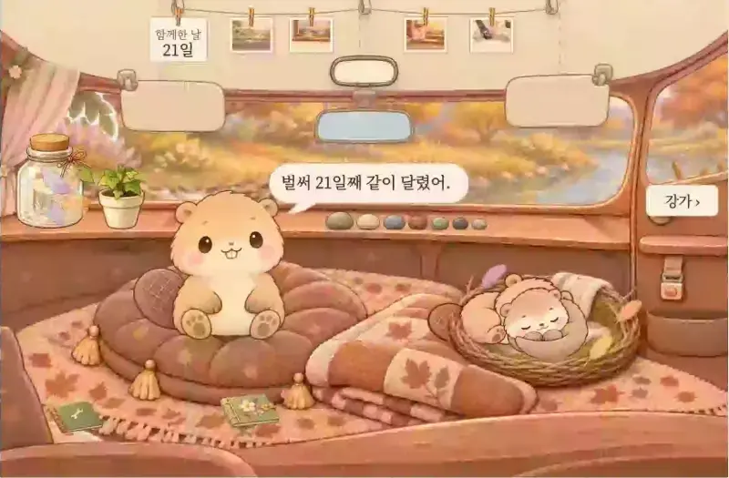

<sub>"찰칵! 도토리가 일어났어." 함께 탄 사람이 안전벨트를 매면 잠들어 있던 아기 정령 도토리가 깨어납니다.</sub>

매일 운전하는 사람과 함께 타는 가족을 위한 차량용 앱<br>
현대자동차그룹 차량용 앱 개발 공모전 출품작 · 차량용 운영체제 Pleos Connect에서 동작 · 아직 출시 전

[구름이 이야기](docs/story.md) · [기능](docs/features.md) · [사용 설명서](docs/manual.md) · [문서](docs/README.md)

</div>

차는 매일 함께 다니지만, 내리고 나면 아무것도 남지 않습니다. 혼자 달린 출근길도, 아이를 태우고 달린 아침도 그렇습니다.

그래서 차 안에 작은 정령 하나가 살게 했습니다. 달리는 동안에는 조용히 지켜보다가, 도착하면 오늘 있었던 일을 들려주는 친구입니다.

## 차와 함께 자랍니다

<div align="center">
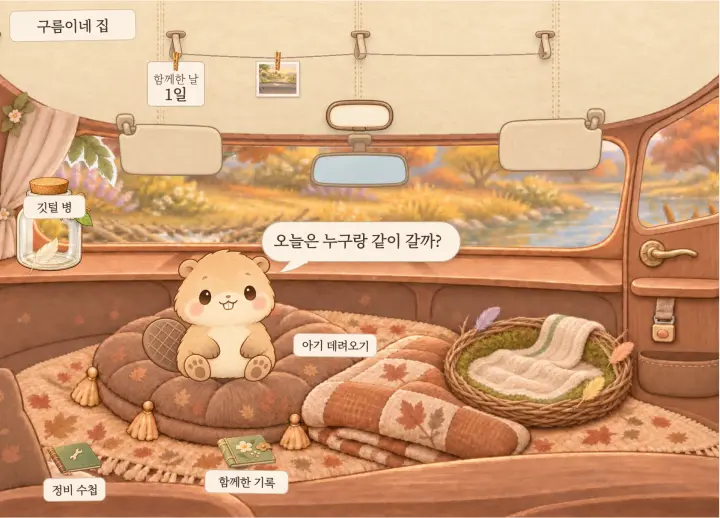
<br><sub>1일에는 작은 구름이와 빈 집이었습니다. 깃털이 쌓이면 몸이 자라고, 선물로 고른 목도리와 소품, 기념일 그림이 집에 늘어납니다.</sub>
</div>

달린 시간과 좋은 습관은 깃털이 되어 병에 모입니다. 병이 차면 새 옷이나 동작, 집 안 소품, 강가 풍경 가운데 하나를 선물로 고릅니다.

<table>
  <tr>
    <td align="center" width="50%"><b>"새 동작을 배웠어."</b><br>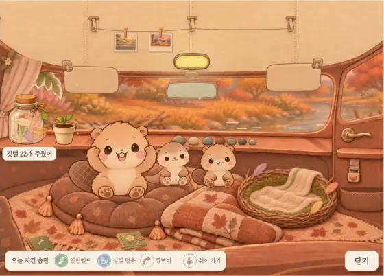<br><sub>살살 멈추는 일이 쌓이면 '살랑살랑 춤'을 배웁니다. 그날의 일기는 P단에 두면 소리 내어 읽어 줍니다.</sub></td>
    <td align="center" width="50%"><b>"앞이 환해졌어. 고마워!"</b><br>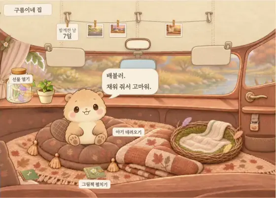<br><sub>주유하면 "배불러." 세차하고 정비 수첩에서 "챙겼어"를 누르면 "앞이 환해졌어." 미뤄도 벌은 없습니다.</sub></td>
  </tr>
</table>

구름이는 점수를 매기지 않습니다. 누가 운전하든, 이 차의 운전 버릇을 닮아 갑니다.

| 이런 일이 쌓이면 | 구름이가 하는 말 |
|---|---|
| 살살 멈추기 | "너를 닮아서 살랑살랑 춤을 자주 춰." |
| 깜빡이 먼저 켜기 | "너를 닮아서 고개를 자주 갸우뚱해." |
| 뒷자리 안전벨트 매기 | "가족을 닮아서 꾸벅 인사를 자주 해." |

정비 수첩은 차의 상태를 구름이의 몸으로 말합니다. 엔진오일 갈 때가 되면 "털이 조금 푸석해.", 에어컨 필터 갈 때가 되면 "코가 간질간질해."라고 합니다. 챙기고 나면 "털이 보드라워.", "숨쉬기가 편해."로 바뀝니다. 전기차에는 엔진오일 줄이 없고, 타이어와 에어컨 필터, 세차 세 가지를 챙깁니다.

## 함께 타는 사람에게

함께 탄 사람이 안전벨트를 매면 그 수만큼 아기 정령이 깨어나 같이 다닙니다. 아이도, 배우자도, 함께 출퇴근하는 동료도 같습니다. 다녀온 날에는 주워 온 것을 내밀고, 그것을 집 옆 강가에 놓아 두면 오리 같은 손님이 놀러 옵니다.

<table>
  <tr>
    <td align="center" width="50%"><b>"첫 찰칵"</b><br>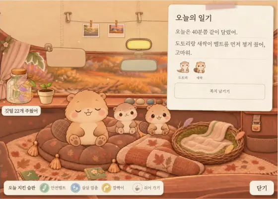<br><sub>처음 함께 벨트를 맨 날은 '첫 찰칵' 그림으로 앨범에 남습니다.</sub></td>
    <td align="center" width="50%"><b>우리 가족</b><br>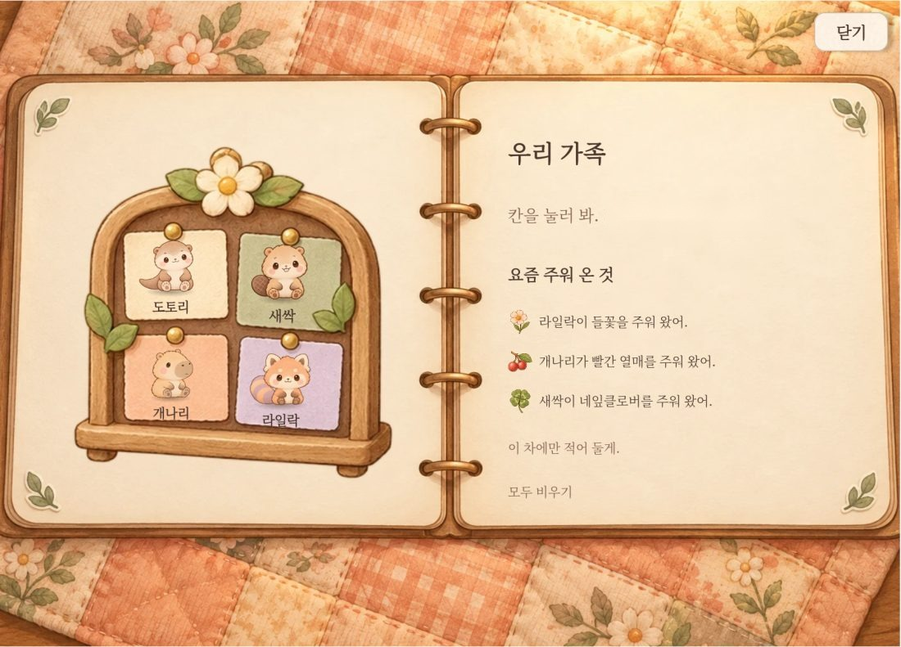<br><sub>조수석과 뒷자리, 넷까지 함께합니다. 아기마다 정해진 자리는 없고, 가족의 실제 이름 대신 아기 이름으로 부릅니다.</sub></td>
  </tr>
</table>

## 함께 달린 날은 남습니다

아이는 자라고, 함께하던 출퇴근길도 언젠가 끝납니다. 그래도 같이 달린 날은 이 차에 남습니다.

<table>
  <tr>
    <td align="center" width="50%"><b>함께한 순간</b><br>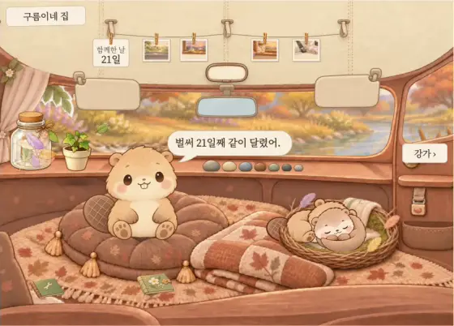<br><sub>처음인 날의 그림과 주워 온 것, 지난 그림책이 앨범에 남습니다.</sub></td>
    <td align="center" width="50%"><b>"처음엔 이만했는데."</b><br>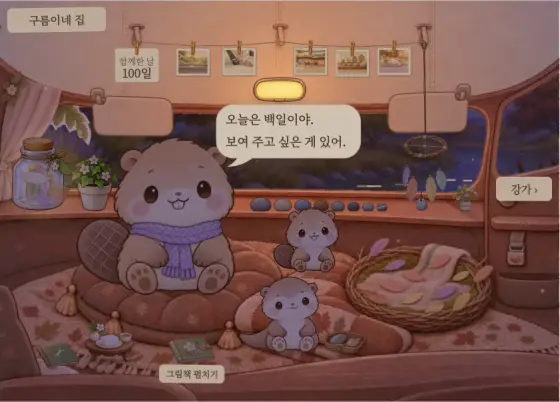<br><sub>기념일마다 지나온 길을 그림책으로 펼칩니다. 몸이 자랐다면 100일 그림책에서 그동안의 키를 나란히 세워 봅니다.</sub></td>
  </tr>
</table>

## 달리는 동안에는 화면을 쉽니다

<table>
  <tr>
    <td align="center" width="50%"><b>출발하면 화면은 쉽니다</b><br>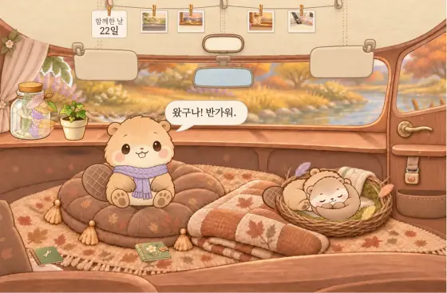<br><sub>출발하면 차가 구름이 화면을 가립니다. 구름이는 말없이 운전을 지켜보고, 출발할 때 차임 한 번, 살살 멈출 때 깃털 소리만 냅니다.</sub></td>
    <td align="center" width="50%"><b>"길이 얼었나 봐. 조심히 가자."</b><br>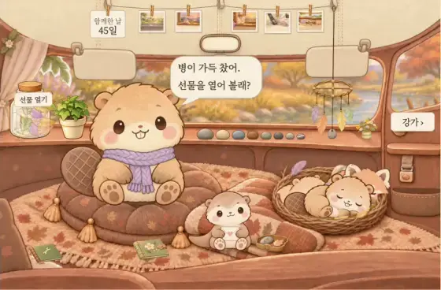<br><sub>시계와 안개등, 빙판 경고를 따라 창밖의 빛과 날씨가 바뀝니다. 말은 P단에서만 합니다.</sub></td>
  </tr>
</table>

<sub>움직이는 그림은 에뮬레이터에서 시연용 데이터를 넣고 녹화했습니다. 날짜, 이름, 거리는 시연 값입니다.</sub>

## 차만 아는 순간

폰은 알 수 없고 차만 아는 순간이 있습니다. 구름이는 그 순간에 반응합니다.

| 차만 아는 순간 | 숫자로 보면 | 구름이에서는 |
|---|---|---|
| 뒷자리 안전벨트 | 뒷좌석 착용률 28%, 운전석 86.4% ([삼성화재 조사](https://www.heraldk.com/article/2025100117575023268), 2025년 상반기) | 벨트를 매면 아기 정령이 깨어납니다 |
| 켜진 경고등 | 경고등이 켜진 채 다니는 차 49% ([미국 CarMD, 2024](https://www.kbb.com/car-news/study-nearly-half-of-us-drive-with-warning-light-on)) | 공기압 경고등이 켜지면 "발이 아파." 하고 몸으로 알려 줍니다 |

## 어떻게 돌아가나

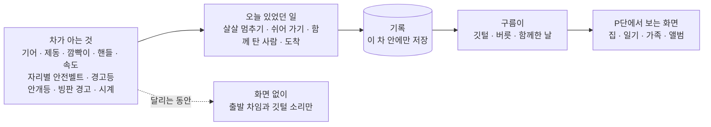

- 위치는 읽지 않고, 차량 신호와 기록은 차 밖으로 보내지 않습니다.
- 무엇을 어떻게 세는지는 [차량 신호와 판단 기준](docs/signals.md), 앱이 어떻게 짜였는지는 [구조](docs/design.md)에 있습니다.

## 실행하기

필요한 것: JDK 17, Android SDK, [Pleos Connect 에뮬레이터](https://document.pleos.ai/docs/connect/guide/getting-started/application-development/setup-connect-sdk-emulator) v2.1

```bash
./gradlew installDebug            # Windows: .\gradlew.bat installDebug
adb forward tcp:8088 tcp:8088     # Virtual Console: http://127.0.0.1:8088
```

빌드하지 않고 깔 때는 서명한 제출 APK를 씁니다.

```bash
adb install apk/gureumi-dev_gureumi_release.apk
```

- 처음 설치하면 앱을 한 번 열어 주세요. 구름이 인사 뒤에 속도 권한을, 첫 도착 뒤에 알림 권한을 묻습니다. 그 뒤로는 에뮬레이터를 켤 때 저절로 시작합니다.
- 차량 상태는 http://127.0.0.1:8088 에 뜨는 [Virtual Console](https://document.pleos.ai/docs/pleos-only/app-test-guide/virtual-console-guide)에서 바꿉니다. 짧은 시연 주행은 `scripts/vc-trip-15s.js`를 그 페이지의 브라우저 콘솔에 붙여 넣어 돌립니다.
- 검증 빌드(debug)에는 안전벨트와 날씨를 바꾸는 시험 입력이 있고, 제출 빌드(release)에는 없습니다.
- 에뮬레이터는 자리별 안전벨트 신호를 바꿔 주지 않습니다. 그래서 아기 정령이 깨어나는 장면은 제출 APK로는 볼 수 없고, 검증 빌드의 시험 입력이나 시연 영상으로 봅니다. 혼자 타는 날의 흐름(출발, 도착 일기, 깃털과 선물, 정비 수첩, 강가)은 제출 APK로 그대로 볼 수 있습니다.
- 단위 테스트 603개는 `./gradlew testDebugUnitTest`로 돌립니다. 시험 입력, 권한, 에뮬레이터 준비는 [개발 환경](docs/development.md)에 있습니다.

## 사용한 기술

| 구분 | 내용 |
|---|---|
| 앱 | [Kotlin](https://kotlinlang.org/) 2.0, [Android Automotive OS](https://source.android.com/docs/automotive) 14 (API 34) |
| 차량 | [Pleos Connect SDK](https://document.pleos.ai/docs/pleos-only/connect-sdk-pleos/): Vehicle 2.3.2, TextToSpeech 3.3.1 (인터넷 없이 읽어 주는 음성) |
| 빌드 | Gradle 8.10.2, Android Gradle Plugin 8.8.2, JDK 17 |
| 검증 | JUnit 단위 테스트 603개, 에뮬레이터 확인 ([검증](docs/verification.md)) |

## 진행 상황

- 2026년 10월 30일에 시작했습니다. 11월 1차 제출, 12월 3~4일 2차 발표, 2027년 2월 전시로 이어집니다.
- 설치 파일(APK)은 `apk/` 폴더에 있습니다. 시연 영상은 1차 제출 때 여기에 붙입니다.

## 만든 사람

1인 개발입니다. 실명은 공모전 규정에 따라 밝히지 않습니다. 기획과 결정, 화면 점검은 직접 했고, 코드와 문서 작업에는 AI 코딩 도구를 함께 썼습니다. 앱의 일러스트는 생성형 이미지 도구로 만들고 사람이 검수했습니다.
