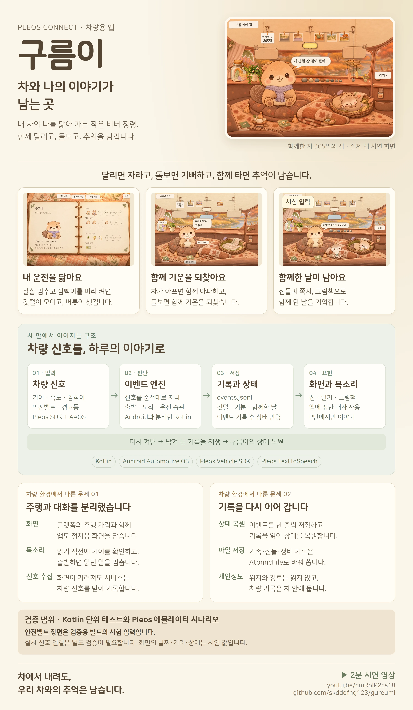

<div align="center">

# 구름이

**차와 나의 이야기가 남는 곳**

내 차와 나를 닮아 가는 작은 비버 정령<br>
현대자동차그룹 차량용 앱 개발 공모전 출품작 · Pleos Connect 차량용 앱

[▶ 2분 시연 영상](https://youtu.be/cmRolP2cs18) · [설치 파일](apk/gureumi-dev_gureumi_release.apk) · [사용 설명서](docs/manual.md) · [문서](docs/README.md)

</div>

차는 매일 함께 다니지만, 내리면 그날의 이야기는 금세 지나갑니다. 혼자 달린 출근길도, 아이를 태운 아침도 그렇습니다.

구름이는 그 시간을 차 안에 남기고 싶어서 만들었습니다. 내 운전 습관을 닮고, 차가 아프면 함께 아파하는 친구입니다. 차를 돌보면 함께 기운을 되찾고, 함께 다녀온 날은 추억으로 남습니다.

<div align="center">
<a href="https://youtu.be/cmRolP2cs18"></a>
<br><sub>포스터를 누르면 시연 영상이 열립니다. <a href="docs/assets/readme/gureumi_poster.png">포스터 크게 보기</a></sub>
</div>

## 달리면, 나를 닮아 갑니다

살살 멈추고 깜빡이를 미리 켜면 깃털이 모입니다. 병이 차면 선물 셋 가운데 하나를 고릅니다. 고른 소품은 집에 놓이고, 옷이나 동작을 고르면 구름이가 새로 익힙니다.

내 운전 습관이 쌓이면 구름이의 버릇도 달라집니다. 살살 멈추는 일이 많았다면, 집에서 살랑살랑 춤을 자주 춥니다.

> “너를 닮아서 살랑살랑 춤을 자주 춰.”

누가 더 잘 운전했는지 순위를 매기지 않습니다. 이 차와 함께 쌓은 습관을 구름이의 모습으로 보여 줍니다.

## 돌보면, 함께 기운을 되찾습니다

구름이는 **차와 운전자의 페르소나**입니다. 차의 상태를 구름이의 몸과 표정으로 만납니다.

타이어 공기압 경고등이 켜지면 쪽지를 들고 알려 줍니다.

> “발이 아파. 타이어 공기압을 봐 줘.”

정비를 마치고 수첩에 기록하면 구름이가 고마워합니다. 세차를 챙긴 뒤에는 창이 맑아지고, 이렇게 인사합니다.

> “앞이 환해졌어. 고마워!”

내 차를 챙기는 일이, 함께 사는 친구를 돌보는 일이 됩니다. 정비를 미뤄도 모은 깃털이나 선물을 빼앗지 않습니다.

## 함께 타면, 추억이 남습니다

뒷자리 안전벨트를 매면 둥지에서 자던 아기 정령이 깨어납니다. 아이와 탄 날도, 배우자나 동료와 함께한 날도 작은 이야기로 이어집니다.

- **주워 온 선물** — 함께 탄 아기가 조약돌이나 네잎클로버를 가져옵니다. 강가에 놓아 두면 다음에 손님이 찾아옵니다.
- **맡겨 둔 한마디** — 함께 다녀온 날, 정해진 문장 중 하나를 아기에게 맡깁니다. 혼자 탄 날 도착하면 구름이가 그 말을 전해 줍니다.
- **함께 자란 시간** — 몸이 자랐다면 100일 그림책에서 키를 나란히 세워 봅니다. 365일에는 함께 보낸 사계절을 펼쳐 봅니다. 집에도 기념 그림이 한 장씩 늘어납니다.

> “도토리가 전해 달래. 많이 사랑해.”

차에서 내려도, 우리 차와의 추억은 남습니다.

## 이야기는 안전하게 주차한 뒤에

달리는 동안에는 앱 화면이 가려집니다. 구름이는 **P단에서만** 말하고, 출발하면 읽던 말과 열려 있던 정차용 화면을 닫습니다. 주행 중 소리는 출발 차임과 짧은 깃털 소리뿐입니다.

도착하면 오늘의 일기와 모은 깃털을 보여 줍니다. 뒷자리 안전벨트를 맨 채 도착한 경우에는 아기가 잠들었을 수 있어 낭독과 효과음을 미룹니다. 자세한 조건은 [말과 소리](docs/voice.md)에 있습니다.

위치와 경로는 읽지 않습니다. 앱이 모은 차량 신호와 기록은 차 밖으로 보내지 않고, 목소리도 기기 안에서 만듭니다.

## 차의 신호가 하루의 이야기로

| 단계 | 하는 일 |
|---|---|
| 차량 신호 | Pleos 차량 SDK와 Android 차량 속성에서 기어, 속도, 깜빡이, 안전벨트, 경고등 등을 받습니다. |
| 이벤트 판단 | 신호를 순서대로 처리해 출발, 도착, 살살 멈추기 같은 일을 알아봅니다. 판단 코드는 Android와 분리한 Kotlin으로 작성했습니다. |
| 기록과 상태 | 이벤트를 `events.jsonl`에 남기고 깃털, 기분, 함께한 날에 반영합니다. 앱을 다시 켜면 기록을 읽어 상태를 복원합니다. |
| 화면과 목소리 | 상태에 따라 집과 일기, 정령의 버릇이 달라집니다. 구름이의 말은 앱에 정한 문장에서 고르며, P단에서만 읽습니다. |

차량 신호는 서비스 한 곳에서 받고, 화면은 계산된 상태를 읽습니다. 가족·선물·정비 기록은 `AtomicFile`로 저장합니다. 전원이 끊기는 상황, 주행 중 화면·음성 제어, 권한이 없는 경우를 나눠 다뤘습니다.

[앱 구조](docs/design.md) · [차량 신호와 판단 기준](docs/signals.md) · [검증과 남은 한계](docs/verification.md)

## 실행하기

**빌드 없이 설치하려면** [서명한 제출 APK](apk/gureumi-dev_gureumi_release.apk)를 사용합니다.

```bash
adb install apk/gureumi-dev_gureumi_release.apk
```

**직접 빌드하려면** JDK 17, Android SDK, [Pleos Connect 에뮬레이터 v2.1](https://document.pleos.ai/docs/connect/guide/getting-started/application-development/setup-connect-sdk-emulator)이 필요합니다. 개발과 시험에 쓴 에뮬레이터는 Android Automotive 14(API 34), 화면 2560×1440, 160dpi입니다.

```bash
./gradlew installDebug            # Windows: .\gradlew.bat installDebug
adb forward tcp:8088 tcp:8088     # Virtual Console: http://127.0.0.1:8088
./gradlew testDebugUnitTest       # 단위 테스트
```

- 처음 설치하면 앱을 한 번 열어 주세요. 구름이의 인사 뒤에 속도 권한을, 첫 도착 뒤에 알림 권한을 묻습니다.
- 차량 상태는 [Virtual Console](https://document.pleos.ai/docs/pleos-only/app-test-guide/virtual-console-guide)에서 바꿉니다. 짧은 시연 주행은 `scripts/vc-trip-15s.js`를 해당 페이지의 브라우저 콘솔에서 실행합니다.
- 권한 설정과 에뮬레이터 준비는 [개발 환경](docs/development.md)에 정리했습니다.

### 시연에서 확인할 수 있는 범위

| 빌드 | 확인 방법 |
|---|---|
| 제출 빌드 (`release`) | 출발과 도착 일기, 깃털과 선물, 성장 기록, 정비 수첩, 강가를 확인할 수 있습니다. 시험 입력은 없습니다. |
| 검증 빌드 (`debug`) | 안전벨트와 날씨 등을 바꾸는 시험 입력이 있습니다. |

**영상과 포스터의 안전벨트 장면은 검증용 빌드의 시험 입력입니다.** 에뮬레이터에는 자리별 안전벨트 신호가 없어, 아기 정령이 깨어나는 장면은 제출 APK만으로 확인할 수 없습니다. 실차 신호 연결은 별도 검증이 필요합니다.

화면은 실제 에뮬레이터에서 녹화했습니다. 날짜와 거리, 상태는 시연 값이며, 도토리와 새싹은 시연용 아기 정령 이름입니다. 영상의 내레이션과 배경음은 영상용으로 따로 만들었고, 구름이 대사 세 줄도 앱 문장 그대로 영상용 목소리로 다시 읽었습니다. 실제 앱에서는 차량 음성 합성으로 말합니다.

## 사용한 기술

| 구분 | 내용 |
|---|---|
| 앱 | Kotlin 2.0 · Android Automotive OS |
| 차량 신호·음성 | Pleos Connect SDK — Vehicle 2.3.2 · TextToSpeech 3.3.1 |
| 상태와 저장 | 이벤트 기록·재생 · JSONL · AtomicFile · SharedPreferences |
| 빌드·검증 | Gradle 8.10.2 · Android Gradle Plugin 8.8.2 · JDK 17 · JUnit · 에뮬레이터 시나리오 |

## 만든 사람

1인 개발 프로젝트이며, 현재 공모전 1차 제출용 앱입니다. 실명은 공모전 규정에 따라 밝히지 않습니다.

기획과 결정, 화면 점검은 직접 했습니다. 코드와 문서 작업에는 AI 코딩 도구를 함께 썼고, 앱의 일러스트는 생성형 이미지 도구로 만든 뒤 검수했습니다.

**달리면 자라고, 돌보면 기뻐하고, 함께 타면 추억이 남습니다.**
