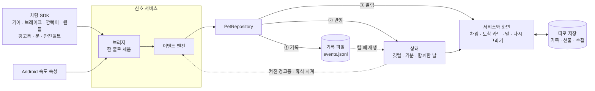

# 구조

구름이는 차 안에서 도는 Android 앱 하나입니다. 차의 신호는 서비스 한 곳에서만 받고, 화면은 기록으로 계산한 상태를 읽기만 합니다. 깃털과 기분이 달라지는 일은 모두 기록 파일에 한 줄이 쌓이면서 시작합니다.

## 다섯 부분

### 신호 서비스

앱 화면이 닫혀 있어도 도는 포그라운드 서비스입니다. 알림 "구름이가 함께 타고 있어요"를 띄워 둔 채 일합니다. 이 알림은 서비스가 뜰 때 올라가 그대로 있고, 주행 중에 새로 띄우는 알림은 없습니다. 알림 권한은 첫 도착 뒤에 묻습니다. Android 13부터는 허락하기 전에 이 알림이 알림창에 보이지 않습니다.

- 차 화면 장치가 부팅하면 그 신호를 받아 저절로 시작합니다. 잠자기에서 깨어날 때는 이 신호가 오지 않을 수 있어 홈을 열 때도 시작합니다.
- 차 신호는 대부분 Pleos 차량 SDK가 건넵니다. SDK는 신호를 여러 스레드에서 보냅니다.
- 서비스 안의 브리지가 신호를 한 줄로 세워 엔진에 차례로 넣습니다.
- 신호가 없어도 15초마다 엔진을 한 번 깨웁니다. 시간으로 판단하는 규칙이 멈추지 않습니다.
- 출발 차임, 도착 카드, 정차 중 말도 서비스가 맡습니다.

### 이벤트 엔진

신호를 "오늘 있었던 일"로 바꾸는 판정기입니다. 이 일을 이벤트라고 부르며, 모두 열여섯 가지입니다.

| 묶음 | 이벤트 | 기록 |
|---|---|---|
| 트립 | 출발, 도착 | 남김 |
| 운전 | 살살 멈추기, 급제동, 깜빡이 켬, 깜빡이 놓침, 쉬어 가기 | 남김 |
| 안전벨트 | 출발 때 맴, 출발 때 안 맴, 뒷자리 부탁, 뒷자리 맴 | 남김 |
| 경고등 | 켜짐, 꺼짐 | 남김 |
| 자리 | 깨어 있는 자리 바뀜, 내림, 다시 탐 | 남기지 않음 |

엔진은 Android 기능을 하나도 쓰지 않는 Kotlin 코드입니다. 시각도 밖에서 받습니다. 그래서 같은 신호를 넣으면 PC의 단위 테스트에서도 같은 이벤트가 나옵니다. 무엇을 어떤 숫자로 알아보는지는 [차량 신호와 판단 기준](signals.md)에 있습니다.

### 기록과 상태 재생

이벤트는 기록 파일 `events.jsonl`에 한 줄씩 덧붙입니다. 한 줄에 이벤트 하나를 JSON으로 적고, 한 번 쓴 줄은 고치지 않습니다.

깃털, 기분, 함께한 날 같은 상태는 따로 저장하지 않습니다. 앱이 켜질 때마다 기록을 처음부터 재생해 계산합니다. 재생은 기록을 차례로 다시 읽으며 상태를 쌓는 일입니다. 그래서 상태가 기록과 어긋나지 않습니다.

기록에 남는 이벤트는 열세 가지입니다. 자리 묶음의 셋은 남기지 않습니다. 트립 기록에는 안전벨트를 맨 자리와 그 시각만 남고, 누가 탔는지와 언제 내렸는지는 남지 않습니다.

### 따로 저장하는 것

재생으로 다시 만들 수 없는 것은 따로 저장합니다. 사람이 고른 것이 대부분이고, 가족 정령처럼 지울 수 있어야 하는 것도 있습니다.

- `family.json`: 가족 정령, 아기가 맡긴 말(정해진 문장의 번호), 다음 도착 때 배웅 장면을 보여 줄 자리
- `gifts.json`: 고른 선물, 앨범, 주워 온 것, 강가 같은 장소
- `care.json`: 정비 수첩, 처음 본 주행거리, 차종
- Android 설정 저장소(SharedPreferences): 회상 설정, 이미 보여 준 것, 소리 내어 읽은 일기

세 JSON 파일은 Android의 `AtomicFile`로 씁니다. 임시 파일에 다 쓰고 fsync한 뒤 한 번에 바꿔 끼워서, 쓰는 중에 전원이 꺼져도 파일이 깨지지 않습니다. 저장은 뒤쪽 스레드 하나가 차례로 맡아서 화면이 기다리지 않습니다.

### 화면

홈, 도착 카드, 가족, 강가, 기록 책, 회상 그림책이 있습니다. 기록 책은 성장 기록, 함께한 기록(앨범), 정비 수첩 세 쪽입니다. 화면은 차 신호를 직접 받지 않습니다. 상태를 읽어 그리고, 이벤트 알림을 받으면 다시 그립니다. 출발 이벤트가 오면 도착 카드와 정차용 화면은 스스로 닫힙니다.

## 데이터가 흐르는 길

1. 신호가 오면 브리지가 받은 시각을 붙여 줄에 세웁니다. 속도만은 차가 신호를 만든 시각을 씁니다. 전달이 밀려도 가짜 감속이 생기지 않습니다.
2. 엔진이 이벤트를 알아보면 `PetRepository`로 넘깁니다.
3. `PetRepository`는 늘 같은 순서로 처리합니다. 기록 파일에 먼저 쓰고, 상태에 반영하고, 마지막에 서비스와 화면에 알립니다.
4. 앱이 다시 켜지면 기록을 재생해 상태를 만듭니다. 켜진 경고등과 휴식 시계는 엔진에 돌려줍니다.

## 전원이 꺼져도 남는 기록

차는 시동을 끄는 순간 전원이 끊길 수 있습니다. 그래서 기록 파일에 한 줄을 쓸 때마다 fsync를 부릅니다. fsync는 운영체제가 잠시 쥐고 있던 내용을 저장장치에 바로 쓰게 하는 명령입니다. 이벤트는 드물게 생겨서 비용이 작습니다.

- 전원이 끊겨 마지막 줄이 잘리면 그 줄만 건너뜁니다. 다음에 쓸 때 줄을 먼저 바꿔서 새 줄은 온전히 남습니다.
- 모르는 종류의 줄이나 값이 깨진 줄도 그 줄만 건너뜁니다. 예전 형식의 줄은 없는 칸을 기본값으로 읽습니다.
- 10월 30일, 에뮬레이터가 갑자기 죽은 뒤 다시 켰을 때 깃털 18개가 그대로 돌아왔습니다. 기록을 손으로 더한 값과 같았습니다.

재생은 깃털만 되살리지 않습니다.

- 시동을 끄고 쉰 시간도 쉬어 가기로 칩니다. 재생이 휴식 시계를 되살려 엔진에 넘깁니다. 휴식 시계는 이어 달린 시간과 주차를 시작한 시각입니다.
- 앱이 꺼진 사이에 정비한 경고등도 알아챕니다. 기록 속 켜진 경고등과 다시 켠 뒤 처음 받은 경고등 목록을 견줍니다.
- 차는 시동 뒤 위성이나 통신망으로 시계를 맞출 수 있습니다. 시계가 2초 이상 옮겨지면 엔진이 재던 시각도 함께 옮깁니다.

한계도 남아 있습니다. P단에 넣고 3초가 지나기 전에 전원이 끊기면 그 트립의 도착이 남지 않습니다. 그동안 모은 습관 깃털은 남지만, 그날 일기와 함께한 날은 빠질 수 있습니다. 실차에서 얼마나 자주 생기는지는 아직 확인하지 못했습니다.

## 플랫폼이 정한 것

### 달리는 동안

Pleos 앱 심사 기준은 게임을 정차 중에만 쓰게 합니다. 운전이 시작되면 화면을 숨겨야 하고, 운전과 무관한 알림도 띄울 수 없습니다.

구름이는 주행 중 사용 표시(Distraction Optimized)를 하지 않았습니다. 그래서 기어가 D, R, N이면 플랫폼이 앱 화면을 가림막으로 덮습니다. 가림막에는 "주행 중에는 사용할 수 없습니다"가 보입니다. 서비스는 가림막과 상관없이 신호를 받고 기록합니다. 앱도 한 번 더 막습니다.

- 출발 이벤트가 오면 도착 카드와 정차용 화면이 닫힙니다.
- 읽던 말을 끊고, 미뤄 둔 말과 예약한 알림을 버립니다.
- 홈은 차의 주행 제한 신호를 받으면 움직임과 첫 안내를 멈춥니다.
- 달리는 동안 나는 소리는 출발 차임과 깃털 소리뿐입니다. 규칙은 [말과 소리](voice.md)에 있습니다.

### 도착 카드가 막힐 때

도착하면 서비스가 도착 카드를 띄웁니다. 앱이 화면에 보이면 카드가 바로 뜹니다. 다른 앱이 앞에 있으면 Android 14가 서비스의 화면 띄우기를 막습니다. 백그라운드 화면 띄우기 차단(`BAL_BLOCK`)입니다.

막혀도 오류가 나지 않아서, 2초 뒤에 카드가 떴는지 직접 봅니다. 안 떴으면 일기를 소리로 읽고 소리 없는 알림을 남깁니다. 알림을 누르면 카드가 열립니다. 사람이 누른 것이라 플랫폼이 허용합니다.

### 권한

제출 빌드는 권한 13개를 선언합니다. 차 신호 8개, 음성 1개, 상주 서비스와 알림 4개입니다. APK에는 SDK와 AndroidX가 넣는 3개가 더해져 16개가 듭니다. 속도 권한은 처음 켠 날 구름이 인사 뒤에, 알림 권한은 첫 도착 뒤에 묻습니다.

- 속도는 차량 SDK에 없어 Android Automotive 표준 차량 속성으로 받습니다. 이 권한은 허락 창에 위치 정보로 뜹니다. 앱은 위치 권한을 선언하지 않습니다.
- 경고등 권한(`PRIVATE_CAR_SAFETY`)은 에뮬레이터에서 받습니다. 실차에서 개인 개발자에게 주는지는 아직 모릅니다.
- 상주 서비스와 부팅 자동 시작을 Pleos가 허용하는지도 아직 확인하지 못했습니다. 허용되지 않으면 앱을 연 동안만 신호를 받습니다.
- 신호 등록은 하나씩 따로 감쌉니다. 권한 하나가 없어도 그 기능만 꺼지고 나머지는 돕니다.
- 검증 빌드는 7개를 더 선언합니다. 와이퍼, 음성 인식, 마이크, 내비게이션 셋, 인터넷입니다.

### 화면

- Pleos 화면에는 앱 창이 한두 개 뜨고, 가로와 세로가 바뀔 수 있습니다. 그래서 화면 방향을 고정하지 않았습니다.
- 픽셀 값 대신 창 크기에 비례해 배치합니다. 창이 바뀌어도 화면을 새로 만들지 않고 다시 배치만 합니다. 도착 카드를 새로 만들면 일기를 또 읽기 때문입니다.
- 기록은 Android 사용자마다 따로 남습니다. 차가 운전자 프로필을 Android 사용자로 나누면, 프로필을 바꾼 운전자에게는 새 구름이가 빈 상태로 시작합니다.

## 개인정보

위치는 읽지 않고, 차 신호와 기록은 차 밖으로 보내지 않습니다. 제출 빌드에는 네트워크로 보내는 코드가 없습니다. 목소리도 기기 안에서 만듭니다.

- 신호를 계속 적어 두지 않습니다. 속도 같은 값은 판단에 필요한 0.5초 동안만 메모리에 두고 버립니다.
- 기록 파일에는 일이 생긴 시각과 그 일의 값만 남습니다. 급제동이면 감속과 시작 속도, 트립이면 길이와 거리와 횟수입니다.
- 누가 탔는지가 아니라 어느 자리였는지만 남깁니다. 사람의 이름과 나이는 받지 않고, 아기 정령 이름은 목록에서 고릅니다.
- 위치와 경로는 읽지 않습니다. 정비 수첩은 정비한 때의 누적 주행거리를 적습니다.
- 모든 파일은 앱 전용 폴더에 두고, Android 백업에서 뺐습니다. 따로 정한 보관 기간은 없습니다. 모두 지우려면 차 설정의 앱 정보에서 구름이 저장 공간을 지우거나 앱을 지웁니다.
- 차의 음성 비서 Gleo가 물어 오면 기분과 켜진 경고등 이름만 답으로 건넵니다. 그 답을 어디에서 처리하는지는 Gleo를 따릅니다.
- 폰 엽서는 QR 주소의 `#` 뒤에 13바이트 숫자만 담습니다. 이름, 위치, 차대번호, 사진은 담지 않습니다. 지금 빌드는 엽서 입구를 숨겼습니다.

밝혀 둘 점이 있습니다. 음성 SDK가 인터넷 권한(`INTERNET`)을, 차량 SDK가 차량 연결 권한(`VEHICLE_BINDING`)을 함께 선언해서 제출 APK에도 남습니다. 앱 코드는 인터넷을 쓰지 않습니다.

## 성능

- 에뮬레이터 전원을 켠 뒤 서비스가 차량 신호를 받을 준비를 마치기까지 7.4초가 걸렸습니다(10월 31일에 한 번 잰 값). 앱을 눌러 첫 프레임이 뜨는 시간(에뮬레이터 0.7~1.2초)과는 다른 값입니다. 이 준비를 메인 스레드 밖에서 해서 앱 응답 없음(ANR)이 나지 않았습니다.
- 홈은 몸짓이 있을 때 초당 15장, 숨만 쉴 때 9장을 그립니다. 뛰기 같은 큰 몸짓을 하는 1~2초만 정령을 초당 20장으로 그립니다.
- 화면이 가려지면 그리기를 멈춥니다. 차가 뜨거워 플랫폼이 일을 줄이라고 하면 움직임을 세 배 느리게 합니다.

준비 시간은 에뮬레이터에서 잰 값이라 실차에서 다시 재야 합니다. 재는 방법과 다른 숫자는 [검증](verification.md)에 있습니다.

## 코드 위치

모두 `app/src/main/java/com/example/pleosapp/` 아래에 있습니다. 빌드와 실행은 [개발 환경](development.md)에 있습니다.

- 신호 서비스: `spike/VehicleProbeService.kt`, 브리지는 `engine/VehicleEngineBridge.kt`
- 이벤트 엔진과 판단 숫자: `engine/DriveEventEngine.kt`의 `EngineConfig`
- 기록과 재생: `engine/EventLedger.kt`, `engine/PetRepository.kt`, `engine/PetState.kt`
- 목소리와 소리: `spike/VoiceProbe.kt`, `spike/SoundProbe.kt`, `engine/TripSounds.kt`
- 화면: `ui/`
- 폴더 이름 `spike`와 패키지 이름 `com.example.pleosapp`은 시제품 때 이름이 그대로 남았습니다. 제출 APK의 앱 ID만 `io.github.skdddfhg123.gureumi`입니다.
