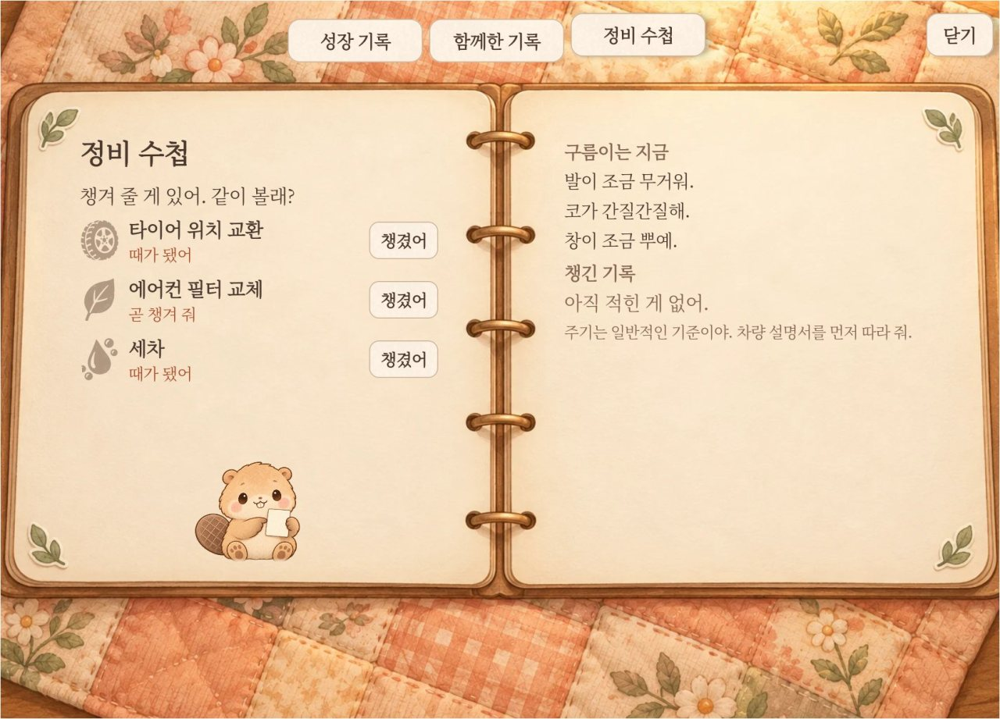
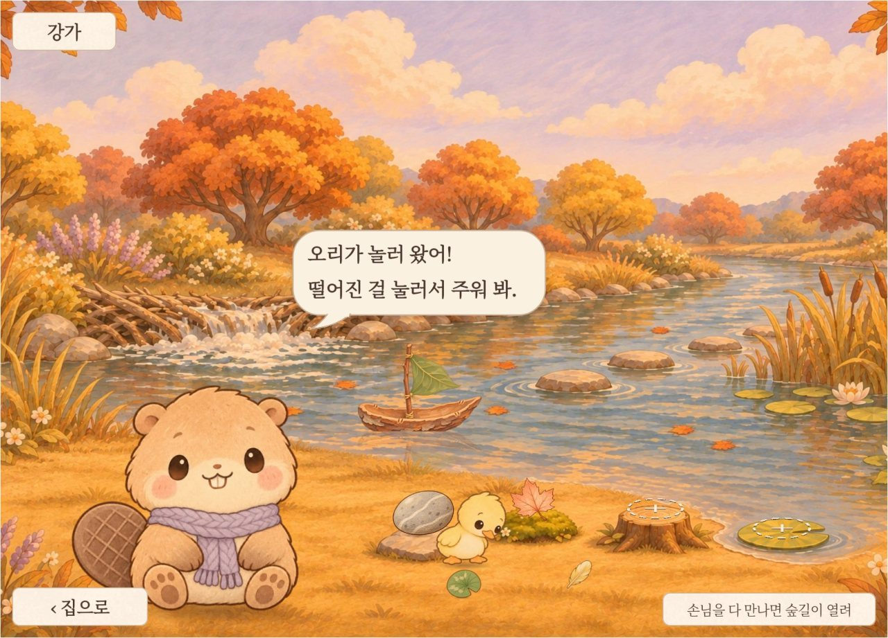
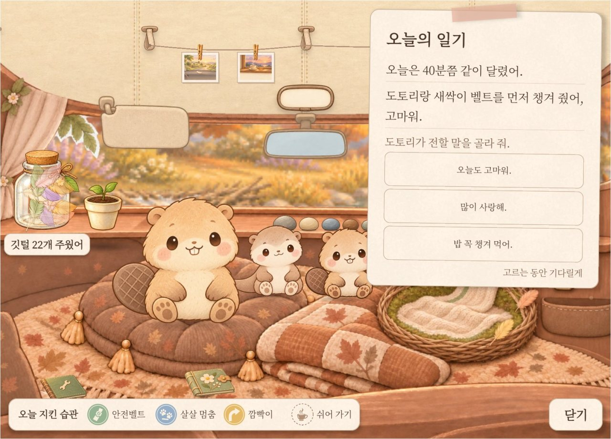

# 기능

구름이는 한 번 열어 두면 시동을 걸 때 함께 켜지도록 만든 앱입니다. 달리는 동안 쌓인 것은 도착한 뒤에 보여 주고, 주행 중에는 화면을 쓰지 않습니다.

## 차와 함께 자랍니다

### 도착하면 오늘의 일기

기어를 P에 3초 두면 도착입니다. 도착 화면에서는 "오늘 지킨 습관"에 도장이 찍히고, 주운 깃털이 병에 쏟아집니다. 이어서 오늘의 일기가 내려오고, 구름이가 소리 내어 읽어 줍니다.

일기는 "오늘은 40분쯤 같이 달렸어."처럼 달린 시간으로 시작합니다. 둘째 줄은 경고등 안내가 먼저이고, 없으면 고마운 일이나 잘한 운전을 말합니다. 부탁은 칭찬할 일이 없던 날에만 한 줄로 합니다.

뒷자리 안전벨트를 맨 채 도착하면 아이가 잠들었을 수 있어 바로 읽지 않습니다. 10초 안에 풀리면 그때 읽고, 밤에는 읽지 않습니다. 다른 앱을 보는 중이었으면 소리로 읽고 알림을 남깁니다.

### 깃털과 선물

달린 시간으로 받는 깃털은 5분마다 하나, 한 번 다녀올 때 8개, 하루 16개까지입니다. 살살 멈추기, 깜빡이 먼저 켜기, 안전벨트, 쉬어 가기에는 깃털이 따로 더 붙습니다. 급제동하거나 깜빡이를 놓쳐도 깃털은 줄지 않습니다.

깃털이 유리병을 채우면 레벨이 하나 오르고, 선물 셋 가운데 하나를 고릅니다. 옷, 동작, 집 안 소품, 강가 풍경 열일곱 가지가 정해진 차례로 후보에 오릅니다. 고르지 않은 선물은 다음 병에 다시 나오고, 열지 않은 선물도 사라지지 않습니다. 병은 깃털 10개짜리에서 시작해 60개짜리까지 커집니다. 열일곱 가지를 다 받은 뒤에는 병에서 구름이의 쪽지가 나옵니다.

받은 옷은 바로 입고, 성장 기록에서 벗기거나 바꿔 입힙니다. 배운 동작은 칸을 누르면 구름이가 해 봅니다.

### 몸이 자라고 버릇이 생깁니다

모은 깃털이 쌓이면 구름이 몸이 커집니다. 솜털, 꼬마, 씩씩이, 듬직이, 어른 다섯 단계입니다. 단계가 오를 때마다 "키 재기" 그림책이 생깁니다. 선물을 열어도 모은 깃털은 줄지 않아, 다시 작아지지 않습니다.

좋은 습관이 쌓이면 새 동작을 배웁니다. 살살 멈추기 30번이면 살랑살랑 춤, 깜빡이 먼저 켜기 50번이면 갸우뚱입니다. 뒷자리 안전벨트 20번이면 꾸벅 인사를 배웁니다.

목표 횟수를 채운 습관 가운데 가장 넉넉히 쌓인 것이 구름이의 버릇이 됩니다. 집 화면에서 그 동작을 자주 하고, 가끔 "너를 닮아서 살랑살랑 춤을 자주 춰."라고 말합니다.

살살 멈추기는 차 속도로 알아보고, 깜빡이는 핸들을 돌린 순간의 속도와 함께 봅니다. 처음 켤 때 묻는 허락 창에는 "위치 정보"로 나오지만, 구름이는 위치를 읽지 않습니다. 허락하지 않아도 달린 시간만큼 깃털은 모입니다.

### 돌보면 기뻐합니다

정비 수첩은 차의 상태를 구름이의 몸으로 말합니다. 엔진오일 교환 때가 다가오면 "털이 조금 푸석해."가 적힙니다. 타이어 위치 교환은 "발이 조금 무거워.", 에어컨 필터는 "코가 간질간질해.", 세차는 "창이 조금 뿌예."입니다.

때가 된 정비를 마치고 "챙겼어"를 누르면 구름이가 고마워하고 수첩에 별이 붙습니다. 엔진오일을 챙기면 부르르 털기, 타이어 위치를 바꾸면 콩콩 뛰기, 에어컨 필터를 갈면 기지개를 배웁니다. 전기차에는 엔진오일 줄이 없어서 세차가 부르르 털기를 가르칩니다.

주기는 엔진오일과 타이어 위치 교환 10,000km, 에어컨 필터 15,000km입니다. 세차는 14일이고, 모두 일반 기준이라 차량 설명서가 먼저입니다. 전기차에는 엔진오일 칸이 없습니다.

경고등이 켜지면 귀여운 말 옆에 실제 용어를 씁니다. 타이어 공기압 경고등에는 "발이 아파. 타이어 공기압을 봐 줘."라고 합니다. 10분 이상 켜져 있던 경고등이 꺼지면 별 하나와 깃털 5개를 받습니다.

주유나 충전 때가 되면 "배가 고파.", 채우면 "배불러."라고 합니다. 세차한 지 일주일이 지나면 구름이네 집 창이 조금씩 뿌예지다가 멈춥니다. 정비를 미뤄도 잃는 것은 없습니다.

 정비 수첩. 시험한 에뮬레이터가 전기차라 엔진오일 칸이 없습니다.

## 함께 타는 사람에게

### 안전벨트를 매면 깨어납니다

처음에는 집 화면의 "아기 데려오기"를 누릅니다. 아기는 비버 새싹, 수달 도토리, 카피바라 개나리, 레서판다 라일락 넷입니다. 아이의 실제 이름은 넣지 않습니다.

아기는 평소 둥지에서 잡니다. 함께 탄 사람이 안전벨트를 매면 탄 사람 수만큼 깨어납니다. 조수석과 2열을 세고, 어른과 아이를 가리지 않습니다.

P단이면 구름이가 "찰칵! 도토리가 일어났어."라고 말합니다. 탄 사람이 모두 안전벨트를 매고 아기가 둘 이상 깨면 "다 모였다! 오늘도 같이 가자."입니다. 뒷자리에 탄 뒤 6초가 지나도 안전벨트가 풀려 있으면 "친구야, 벨트 찰칵해 줄래?" 하고 부탁합니다.

아기마다 정해진 자리는 없습니다. 집 화면에서 자는 아기를 누르면 "도토리가 같이 가고 싶대."라고 하고, 다음에 먼저 깹니다. 나머지는 가장 오래 안 탄 아기부터 깹니다.

P단에서 내리면 아기가 손을 흔듭니다. 1시간 이상 내려 있다가 P단일 때 다시 타면 "왔구나! 도토리가 반가워해."라고 반깁니다.

### 주워 온 것과 강가

함께 다녀오면 세 번에 두 번은 아기가 조약돌이나 나뭇잎을 주워 와 두 손으로 내밉니다. 혼자 다녀오면 세 번에 한 번 구름이가 주워 옵니다. 물건은 매끈한 돌, 단풍잎, 작은 조개처럼 열두 가지입니다.

첫 물건을 주워 온 날 강가가 열리고, 집 화면에서 왼쪽으로 넘기면 갑니다. 물가의 동그라미 네 곳에 주워 온 것을 놓습니다. 다음에 도착하면 그 물건을 좋아하는 손님이 다녀갑니다.

손님은 오리, 개구리, 물총새입니다. 뽑기가 아니라 놓아 둔 물건으로 정해지고, 놓은 물건은 줄지 않습니다. 손님이 떨어뜨린 깃털이나 연잎을 누르면 주워서 성장 기록의 "강가 손님"에 붙입니다.

 물가에 매끈한 돌과 단풍잎을 놓아 두자 오리가 놀러 왔습니다.

### 쪽지 남기기

함께 다녀온 날 도착 화면에서 "쪽지 남기기"를 누르면 아기에게 한마디를 맡깁니다. 정해진 문장 가운데에서 고르고, 녹음이나 직접 쓰기는 없습니다.

맡은 아기는 집 화면에서 쪽지를 들고 기다립니다. 운전자가 혼자 5분 넘게 달린 날, 구름이가 일기로 전해 줍니다. "도토리가 전해 달래. 많이 사랑해." 같은 한 줄입니다.

 함께 다녀온 날의 도착 화면. 아래에 오늘 지킨 습관이 찍히고, 일기장에서 쪽지에 담을 말을 고릅니다.

### 함께 탈수록

아기의 몸은 자라지 않습니다. 대신 아기 정령과 함께 탄 횟수를 세고, 그만큼 아기들이 할 줄 아는 일이 늘어납니다. 3번이면 자기 몸짓을 보이고, 10번이면 구름이 일을 돕습니다. 30번이면 구름이와 함께 놉니다.

아기와 함께 탄 날마다 선반에 조약돌이 하나씩 놓이고, 여덟 개까지 늡니다. 횟수는 가족 전체로 하나만 세고, 아기별로도 사람별로도 나누지 않습니다. 아기 없이 누군가와 함께 탄 날은 "오늘은 같이 타서 든든했어."라고 적습니다.

## 함께 달린 날은 남습니다

### 함께한 날과 기념 그림

하루에 한 번이라도 다녀오면 벽의 "함께한 날"이 하루 늡니다. 여러 번 달려도 하루는 하루이고, 안 탄 날이 있어도 줄지 않습니다. 다음 기념일까지 남은 날은 보여 주지 않습니다.

기념일은 3·7·14·30·50·100·200·300·365·500·730·1000일이고, 그 뒤는 500일마다입니다. 첫날과 기념일마다 천장 줄에 기념 그림이 한 장 걸립니다. 다섯 장이 넘으면 첫날과 최근 넷을 남깁니다.

작은 화분을 받았다면 화분도 함께한 날만큼 자랍니다. 100일에 꽃이 피고, 365일에 덩굴이 늘어집니다. 100일부터 1000일까지는 기념일마다 방에 백설기가 놓입니다.

### 그림책

기념일부터 일주일 동안 집 화면의 "함께한 기록" 이름표가 "그림책 펼치기"로 바뀝니다. 누르면 3~5쪽짜리 그림책을 구름이가 한 쪽씩 읽어 줍니다. 저절로 열리지는 않습니다.

100일 그림책은 몸이 자랐다면 "처음엔 이만했는데." 하며 지금까지의 키를 나란히 세웁니다. 365일 그림책은 봄, 여름, 가을, 겨울을 차례로 넘깁니다. 마지막 쪽에서는 "사계절을 같이 지났어. 앞으로도 여기 있을게."라고 합니다.

### 앨범과 한 줄 회상

앨범(함께한 기록)의 "함께한 순간"에는 처음인 날이 예고 없이 들어갑니다. 여덟 칸은 첫 찰칵, 다 모인 날, 건넨 쪽지, 고마운 날, 첫 보물, 첫 배웅, 첫 반김, 쉬어 간 날입니다. 가장 최근 일기와 친구들이 주워 온 것, 지난 그림책도 앨범에 있습니다.

1년 전 그날이 돌아오면 집 화면에서 "1년 전 오늘, 처음 같이 달렸어." 같은 한 줄을 꺼냅니다. 하루에 한 번뿐입니다.

### 가려 두기

가족이 바뀌어 회상이 마음에 걸리면 앨범이나 그림책의 "가려 두기"를 엽니다. "날짜 숨기기"는 그림책에서 날짜를 빼고, "회상 끄기"는 그림책과 벽의 사진을 내립니다. 회상 문장에는 처음부터 사람 이름과 자리, 누가 몇 번 탔는지를 넣지 않습니다. 아기를 모두 빼면 그림책의 가족 쪽도 다른 이야기로 바뀝니다.

## 달리는 동안에는 화면을 쉽니다

### 화면 대신 짧은 소리

출발하면 차가 구름이 화면을 가립니다. 열려 있던 도착, 가족, 기록, 강가, 그림책 화면도 스스로 닫힙니다. 구름이의 말은 P단에서만 합니다.

달리는 동안 내는 소리는 출발할 때 차임 한 번, 살살 멈출 때 깃털 소리뿐입니다. 깃털 소리는 한 번 다녀올 때 세 번까지, 1분 이상 띄어서 냅니다. 뒷자리 안전벨트를 맸으면 아이가 잘 수 있어 깃털 소리도 내지 않습니다.

### 긴 길에서 쉬어 가기

한 시간 이상 달린 뒤 15분 이상 쉬고, 두 시간 안에 다시 출발하면 쉬어 가기로 셉니다. 깃털이 더 붙고, 도착 화면에 "쉬어 가기" 도장이 찍힙니다. 처음 쉬어 간 날은 앨범에 남습니다.

밤, 비, 장거리처럼 위험한 운전을 부를 수 있는 조건에는 깃털을 더 주지 않습니다. 달린 시간으로 받는 깃털에도 하루 상한을 두었습니다.

### 시간과 날씨

방과 창밖은 차의 시계를 따라 아침, 낮, 해 질 녘, 밤으로 바뀝니다. 맑은 날에는 계절 따라 꽃잎, 민들레 솜털, 반딧불, 낙엽, 눈송이가 날립니다. 밤에는 유리병 속 깃털이 은은하게 빛나고, 가만히 두면 구름이도 졸다가 잠듭니다.

날씨는 서버나 위치 없이 차 신호로 읽습니다. 안개등을 켜면 안개가 끼고, 빙판 경고가 뜨면 눈이 오며, 말풍선도 따라 바뀝니다. 비 오는 장면은 와이퍼 권한이 필요해 아직 검증 빌드에만 있습니다. Pleos 심사에서 권한을 받으면 넣습니다.

## 앞으로

가족에게 보내는 폰 엽서는 2차 발표 때 켭니다. 주차 중 화면의 QR을 폰으로 찍으면 설치 없이 그날의 엽서가 열립니다. 엽서 내용은 QR 주소 안에 숫자로만 담깁니다. 서버로 보내지 않고, 이름과 위치, 사진은 담지 않습니다.

---

왜 만들었는지는 [구름이 이야기](story.md)에 있습니다. 쓰는 방법은 [사용 설명서](manual.md)에, 무엇을 어떻게 세는지는 [차량 신호와 판단 기준](signals.md)에 있습니다. 대사와 소리는 [말과 소리](voice.md)에 모았습니다. 그림은 에뮬레이터에서 시연용 데이터를 넣고 찍었습니다.
