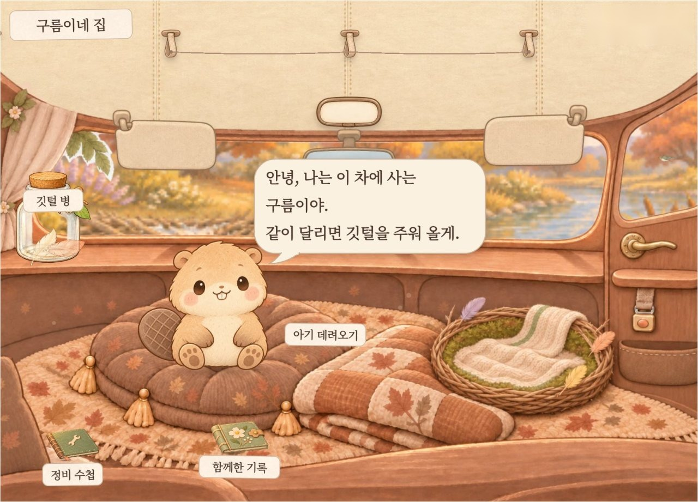
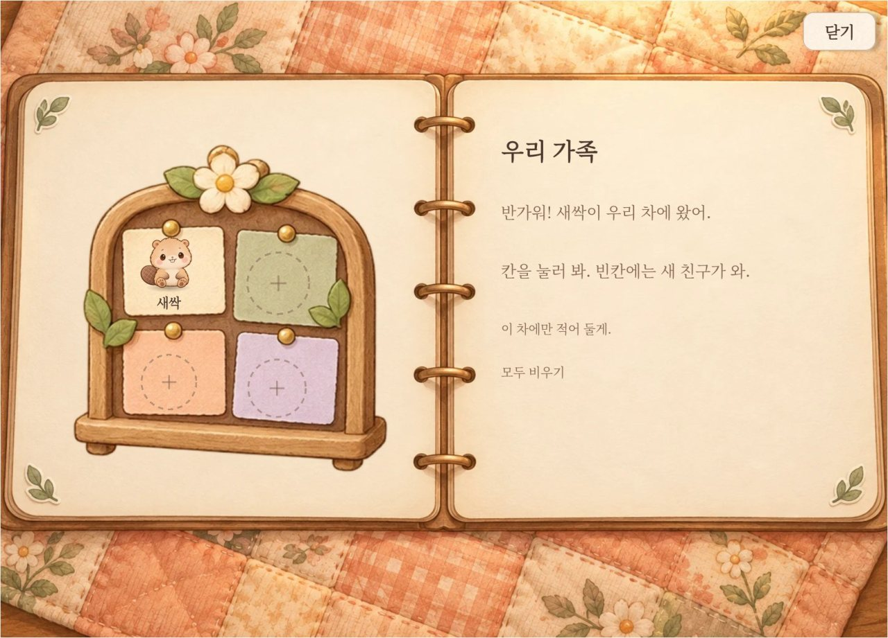
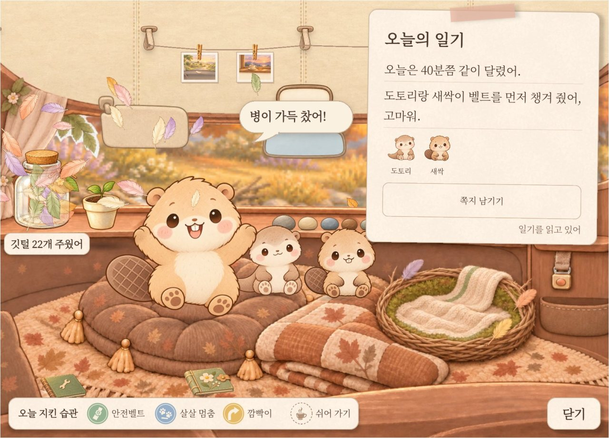
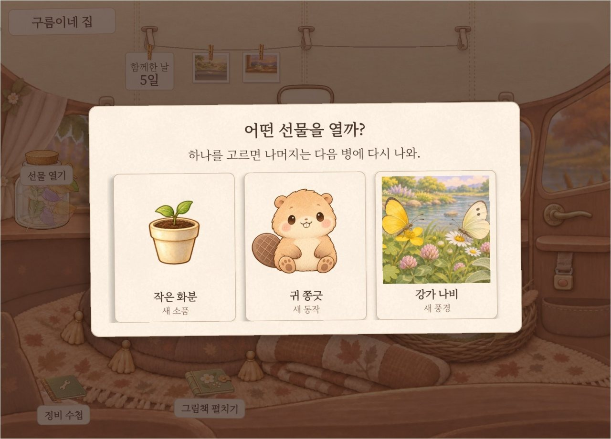
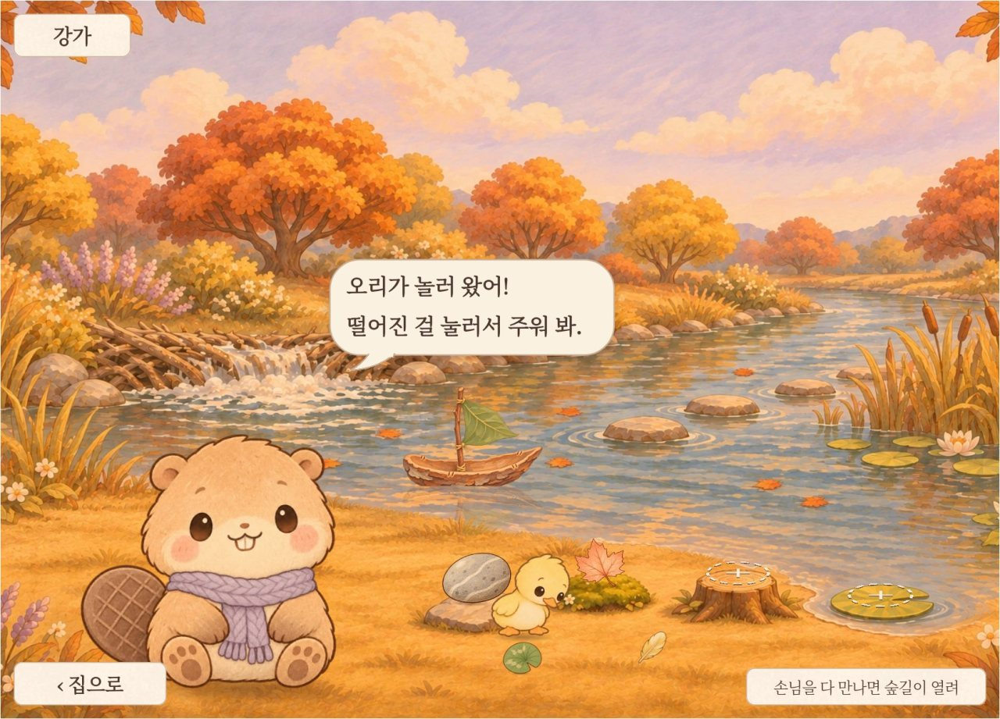
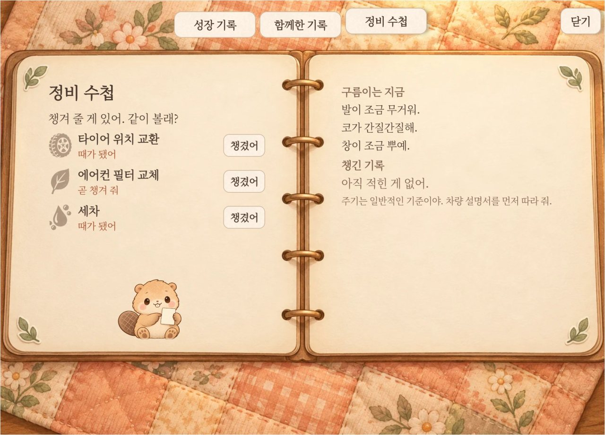
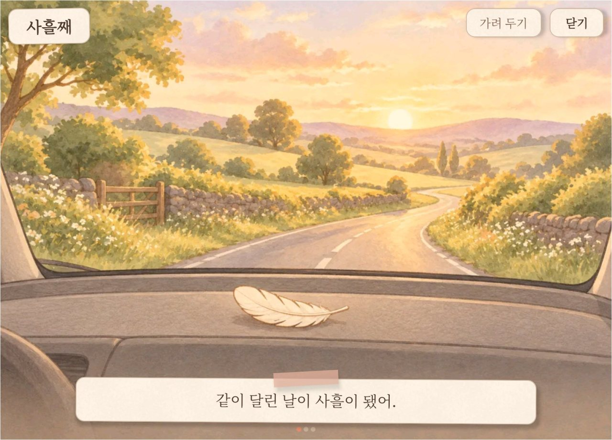

# 구름이 사용 설명서

구름이는 차에 켜 두고 다니는 앱입니다. 달리는 동안에는 조용히 지켜보고, 차를 세우면 그날 있었던 일을 일기로 들려줍니다.

## 안전 먼저

주행 중에는 구름이 화면을 볼 일도, 누를 일도 없습니다. 출발하면 차가 화면을 가리고, 구름이도 열려 있던 화면을 스스로 닫습니다.

- 구름이는 기어가 P단일 때만 말합니다. 일기 낭독, 아기 인사, 안전벨트 부탁 모두 차를 세운 뒤입니다.
- 달리는 동안 나는 소리는 둘입니다. 출발할 때 차임 한 번, 살살 멈출 때 깃털 소리입니다. 깃털 소리는 한 번 다녀오는 동안 세 번까지만 냅니다.
- 뒷자리 안전벨트를 맸으면 깃털 소리는 내지 않습니다. 아이가 자고 있을 수 있어서입니다.
- 구름이의 말은 경고등을 대신하지 않습니다. 경고등이 켜지면 차량 취급설명서를 먼저 따릅니다.
- 아이의 안전벨트는 어른이 직접 확인합니다. 아기 정령이 깼는지로 판단하지 않습니다.

언제 말하고 언제 조용한지는 [말과 소리](voice.md)에 있습니다.

## 처음 따라 하기

1. **켜기.** 기어를 P단에 두고 앱 목록에서 구름이를 누릅니다. 한 번 열고 나면 다음부터는 시동을 걸 때 저절로 켜집니다.

2. **첫 인사.** 구름이가 세 마디로 인사합니다. 말풍선을 누르거나 7초가 지나면 다음 마디로 넘어갑니다.
    - "안녕, 나는 이 차에 사는 구름이야. 같이 달리면 깃털을 주워 올게."
    - "깃털이 저 병에 가득 차면 선물을 하나 골라 줘." 이때 깃털 병이 한 번 부풀며 빛납니다.
    - "아기 데려오기를 눌러 봐. 같이 탈 친구가 와." 이때 그 이름표가 통통 튑니다.

    

3. **속도 허락.** 셋째 마디 뒤에 구름이가 "속도를 봐도 될까?" 안내 카드를 펼칩니다. 카드를 누르면 속도 허락 창이 뜹니다. 창에 '위치 정보'라고 나와도 구름이는 차 속도만 봅니다.

4. **가족 들이기.** "아기 데려오기"를 누르고 새싹, 도토리, 개나리, 라일락 가운데 하나를 고릅니다. 고른 아기는 카드판 빈칸에 들어오고, 구름이가 반겨 줍니다. 넷까지 들일 수 있습니다.

    

5. **처음 달리고 도착하기.** 함께 탄 사람이 안전벨트를 매면 "찰칵!" 하고 아기가 깨어납니다. 아기마다 정해진 자리는 없고, 탄 사람 수만큼 함께 갑니다. 다녀와서 기어를 P단에 3초 두면 "오늘의 일기"가 펼쳐집니다. 처음 다녀오면 주워 온 물건이 하나 생기고 강가가 열립니다. 도착 카드를 닫고 집으로 돌아오면 알림을 허락할지 묻습니다. 허락하면 다른 앱을 보다 도착해도 일기 알림이 옵니다.

아기들이 어떤 친구인지는 [구름이 이야기](story.md)에 있습니다.

## 하루 흐름

- **타기.** 자는 아기를 누르면 "도토리가 같이 가고 싶대."라는 말과 함께 손을 흔듭니다. 안전벨트를 매면 부른 아기부터 깨어납니다. 혼자 타는 날은 아기가 둥지에서 잡니다.
- **달리기.** 화면은 쉽니다. 달린 시간 5분마다 깃털이 하나 모입니다. 살살 멈추기, 깜빡이 먼저 켜기, 안전벨트, 쉬어 가기(1시간 이상 달린 뒤 15분 이상 쉬기)에는 깃털을 더 받습니다.
- **도착 일기.** 기어를 P단에 두면 구름이가 일기를 읽어 줍니다. "오늘 지킨 습관"에 도장이 찍히고, 깃털이 병에 쏟아집니다.
- **집 화면에서.** 병이 차면 선물을 고르고, 주워 온 물건은 강가에 놓습니다. 정비를 했으면 정비 수첩에 적습니다. 밤에 40초 동안 아무도 만지지 않으면 구름이가 졸다가 잠듭니다.

무엇을 살살 멈추기로 세는지는 [차량 신호와 판단 기준](signals.md)에 있습니다.

## 화면별 누를 곳

### 집

- 구름이를 누르면 대답하고, 길게 누르면 쓰다듬습니다. 깨어 있는 아기를 누르면 가족 화면이 열립니다.
- 깃털 병은 성장 기록으로, 바닥의 책 두 권을 누르면 정비 수첩과 함께한 기록(앨범)이 열립니다. 볼 것이 생기면 책 옆에 주황 점이 뜹니다.
- 함께한 날이 사흘이 되기 전까지는 이름표가 늘 보입니다. 그 뒤로는 화면을 만지면 6초 동안 보입니다.

### 도착 일기

- 집과 정령이 먼저 보이고, 오른쪽에 "오늘의 일기"가 내려옵니다. 다 읽고 나면 몇 초 뒤 저절로 닫힙니다.
- 화면을 만지면 그때부터 10초는 열려 있습니다. 선물이나 쪽지를 고르는 동안에는 시간을 세지 않습니다. 다만 카드 하나가 열린 지 30초가 지나면 닫힙니다. "닫기"로 바로 닫을 수 있습니다.
- 함께 탄 아기가 있으면 "쪽지 남기기"가 나옵니다. 고른 한마디는 아기가 쪽지로 들고 기다립니다. 혼자 5분 넘게 운전한 날 구름이가 일기로 전해 줍니다.

### 가족

- 깨어 있는 아기를 누르거나, 아무 아기나 길게 누르면 열립니다. 빈칸을 누르면 새 아기를 데려옵니다.
- 아기 칸을 누르면 "가족에서 빼기"가 나옵니다. 빼기와 "모두 비우기"는 되돌릴 수 없고, 맡긴 쪽지도 함께 지워집니다.
- "이 차에만 적어 둘게."는 가족 기록이 차 밖으로 나가지 않는다는 뜻입니다.

### 성장 기록과 선물

- 병이 차면 병을 누르고 선물 셋 가운데 하나를 고릅니다. 고르지 않은 둘은 다음 병에 다시 나옵니다. 병이 찼을 때 바로 열지 않아도 선물은 그대로 기다립니다.
- 성장 기록 왼쪽에는 레벨과 함께한 날, 구름이가 닮은 버릇이 있습니다. 레벨은 병을 하나 채울 때마다 하나 오릅니다. 오른쪽 "모습" 칸을 누르면 옷을 입히고 벗깁니다. "배운 동작" 칸을 누르면 구름이가 해 봅니다.
- 잠긴 칸을 누르면 얻는 법이 나옵니다. "Lv.9에서 열려.", "엔진오일 교환을 챙기면 배워." 같은 말입니다. 전기차에서는 "세차를 챙기면 배워."로 나옵니다.

### 강가

- 처음 다녀온 뒤 집 오른쪽의 "강가 ›"를 누르거나 화면을 왼쪽으로 넘깁니다. 집으로는 "‹ 집으로"를 누르거나 오른쪽으로 넘깁니다.
- 물가의 빈 동그라미를 누르고 주워 온 물건을 놓습니다. 다음에 도착할 때 그 물건을 좋아하는 손님이 놀러 옵니다.
- 손님이 떨어뜨린 흔적을 누르면 주워서 성장 기록의 "강가 손님"에 붙입니다. 손님은 오리, 개구리, 물총새입니다.

### 정비 수첩

- 정비를 마친 뒤 "챙겼어"를 누릅니다. 아직 때가 아닌 곳은 한 번 더 묻습니다. 잘못 눌렀으면 "챙겼어"를 누른 뒤 5초 안에 "되돌리기"를 누릅니다.
- "곧 챙겨 줘"나 "때가 됐어"인 곳을 챙기면 ★이 붙습니다. 경고등이 켜진 동안에는 "지금 살펴볼 곳"이 먼저 나옵니다.
- 주기는 일반 기준이라 차종마다 다릅니다. 엔진오일 교환과 타이어 위치 교환은 10,000 km마다 챙깁니다. 에어컨 필터 교체는 15,000 km, 세차는 14일마다입니다. 전기차에는 엔진오일 칸이 없습니다. 주행거리는 구름이를 처음 켠 날부터 셉니다. 얼마 전에 정비했다면 그 칸의 "챙겼어"를 눌러 맞춰 둡니다.

### 앨범과 그림책

- "함께한 기록"에는 지난 일기, 주워 온 것, 함께한 순간 여덟 칸이 있습니다. 순간 그림을 누르면 크게 봅니다.
- 함께한 날이 3일, 100일처럼 기념할 날이 되면 그림책이 한 권 생깁니다. 일주일 동안 "함께한 기록" 이름표가 "그림책 펼치기"로 바뀝니다. 지난 그림책은 앨범에 꽂혀 있습니다.
- 그림책은 구름이가 쪽마다 읽고, 화면을 누르면 넘어갑니다. 가족이 바뀌어 지난날이 마음에 걸리면 "가려 두기"에서 "날짜 숨기기"나 "회상 끄기"를 켭니다.

## 자주 묻는 질문

**도착했는데 일기가 안 떠요.** 기어를 P단에 3초 두어야 도착입니다. 아주 잠깐(8초 안) 움직였으면 띄우지 않습니다. 다른 앱을 보던 중이면 일기를 소리로 읽고 "도착! 구름이의 일기" 알림을 남깁니다.

**일기를 소리 내어 읽지 않아요.** 뒷자리 안전벨트를 맨 채 도착하면 아이가 자는 것으로 보고 10초를 기다립니다. 그사이 뒷자리 안전벨트가 모두 풀리면 읽지만, 밤에는 풀려도 읽지 않습니다. 알림을 눌러 연 일기는 이미 읽었으니 다시 읽지 않습니다.

**안전벨트를 맸는데 아기가 안 깨요.** 가족 화면에서 아기를 데려왔는지 먼저 봅니다. 구름이는 조수석과 2열 안전벨트만 셉니다. 3열은 아직 읽지 않습니다.

**아이마다 아기를 정해 줄 수 있나요?** 정해 둘 수는 없습니다. 타기 전에 집 화면에서 자는 아기를 누르면 그 아기가 먼저 깹니다.

**쪽지는 누가 누구에게 보내나요?** 함께 다녀온 날 도착 화면에서 한마디를 골라 아기에게 맡깁니다. 다음에 운전자가 혼자 5분 넘게 달린 날, 구름이가 일기로 전해 줍니다.

**못 들은 일기를 다시 볼 수 있나요?** 가장 최근 일기는 함께한 기록(앨범)의 "지난 일기"에서 글로 다시 봅니다.

**속도 허락 창에 왜 '위치 정보'가 나오나요?** 차 시스템이 차 속도를 위치 권한 묶음에 넣어 두었기 때문입니다. 창 이름은 '위치 정보'지만 구름이가 받는 것은 차 속도뿐이고, 위치는 읽지 않습니다. 허락하지 않아도 달린 시간만큼 깃털이 모입니다. 다만 살살 멈추기와 깜빡이는 알아보지 못합니다. 거절했어도 다음에 구름이를 새로 열면 한 번 더 묻습니다.

**운전 점수가 있나요?** 없습니다. 순위와 벌도 없습니다. 급제동을 해도 깃털을 빼앗지 않고, 일기에서 천천히 멈춰 달라고 부탁하기도 합니다.

**기록은 어디에 남나요?** 이 차 안의 앱에만 남습니다. 구름이는 기록을 인터넷으로 보내지 않습니다. 위치, 사진, 목소리는 저장하지 않습니다. 자세한 내용은 [구조](design.md)에 있습니다.

## 아직 안 되는 것

- 폰으로 받아 보는 QR 엽서는 아직 꺼 두었습니다. 2차 발표 때 켭니다. 강가 손님을 다 만나면 숲길이 열리지만, 숲길 안은 아직 준비 중입니다.
- 지금까지 실제 차가 아닌 시험용 에뮬레이터에서만 확인했습니다. 실제 차에서는 아직 써 보지 못했습니다.
