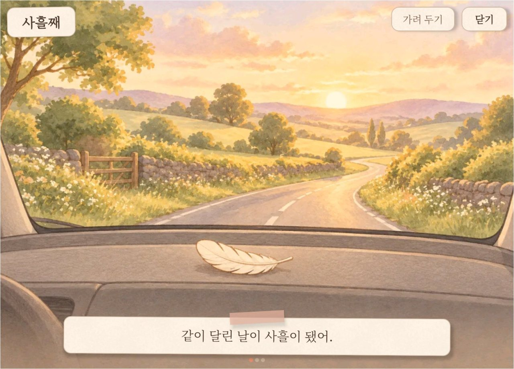

# 구름이 이야기

구름이는 이 차에 사는 작은 비버 정령입니다. 매일 운전하는 사람과 그 차에 함께 타는 사람을 위해 만들었습니다.

## 내리면 끝나는 시간

매일 운전하지만 남는 것이 없습니다. 잘 달려도 알아주는 이가 없고, 운전은 즐거움보다 일과에 가깝습니다. 아이를 태운 아침도, 동료와 나눠 탄 퇴근길도 차에서 내리면 그대로 끝납니다.

내비와 보험 앱은 운전 습관을 점수로 매깁니다. 점수는 평가로 끝나고, 한번 안정되면 더 볼 이유가 줄어듭니다. 평가 대신 보람을 돌려주고 싶었습니다.

차는 폰과 다릅니다. 달리는 동안에는 화면을 볼 수 없습니다. 그래서 자리를 비운 사이 자라는 방치형 게임에서 답을 찾았습니다.

달리는 동안 쌓이고, 도착하면 무언가 달라져 있습니다. 다만 저절로 자라기만 하면 내 것이 되지 않습니다. 얼마나, 어떻게 달렸는지가 구름이를 키우는 재료가 됩니다.

## 차만 아는 순간

폰은 모르고 차만 아는 순간이 있습니다. 함께 탄 사람이 안전벨트를 매는 순간, 계기판에 경고등이 켜지는 순간입니다. 사람들은 이 신호를 자주 놓칩니다.

고속도로 요금소 AI 관측에서 뒷좌석 안전벨트 착용률은 28%였습니다. 운전석 86.4%와 큰 차이입니다([삼성화재 조사](https://www.heraldk.com/article/2025100117575023268), 2025년 상반기). 미국에서는 경고등이 켜진 채 다니는 차가 49%였습니다([차량 진단 업체 CarMD](https://www.kbb.com/car-news/study-nearly-half-of-us-drive-with-warning-light-on), 2024).

구름이는 이 신호를 점수로 바꾸지 않습니다. 함께 탄 사람이 안전벨트를 매면 아기 정령이 깨어납니다. 공기압 경고등이 켜지면 구름이가 "발이 아파. 타이어 공기압을 봐 줘."라고 말합니다.

## 차에 사는 작은 비버

비버는 물길만 있으면 집을 짓고, 물이 새는 소리가 들리면 고칩니다. 털을 빗고, 겨울 먹이를 모으고, 가족과 함께 삽니다. 집 짓기, 돌봄, 가족이 한 동물에 다 있어서 비버를 골랐습니다.

작은 비버에게 길은 강이고, 차는 강 위의 집입니다. 부드럽게 달린 날은 물살이 잔잔하고, 잔잔한 물에 쉬어 간 새가 깃털을 떨굽니다. 구름이는 그 깃털을 유리병에 모읍니다.

함께 탄 사람이 안전벨트를 찰칵 채우면 집 문이 잠깁니다. 그제야 둥지에서 자던 아기 정령이 안심하고 깨어납니다.

구름이라는 이름은 몽실한 머리털을 보고 붙였습니다. 아기 정령 넷도 자연에서 이름을 빌렸습니다. 넷은 생김새가 달라서 작은 화면에서도 알아볼 수 있습니다.

- 새싹은 아기 비버입니다. 무엇이든 크기순으로 줄 세우기를 좋아합니다.
- 도토리는 아기 수달입니다. 장난을 좋아하고, 주워 온 돌을 두 손으로 건넵니다.
- 개나리는 아기 카피바라입니다. 느긋해서 등에 잎을 얹고 쉬기를 좋아합니다.
- 라일락은 아기 레서판다입니다. 낯을 가리지만, 친해지면 조용히 사진을 챙깁니다.

## 점수 대신 닮아 갑니다

주인공은 운전자입니다. 구름이는 운전을 평가하지 않고, 쌓인 습관을 버릇으로 따라 합니다.

살살 멈추는 일이 쌓이면 살랑살랑 춤을 자주 춥니다. 깜빡이를 먼저 켜는 일이 쌓이면 고개를 자주 갸우뚱합니다. 뒷자리 안전벨트를 챙기는 가족이 있으면 꾸벅 인사를 배웁니다.

운전자가 여럿이어도 구름이는 이 차가 달려 온 방식을 닮습니다. 그래서 같은 구름이라도 차마다 버릇이 다릅니다.

차를 돌보는 일도 같습니다. 엔진오일 교환 때가 다가오면 수첩에 "털이 조금 푸석해."가 적힙니다. 챙기고 나면 "털이 보드라워."로 바뀝니다.

## 혼자 타도, 함께 타도

혼자 타는 날이 많아도 괜찮습니다. 아기를 들이지 않아도 구름이는 자랍니다. 혼자 다녀온 날에도 가끔 오는 길에 주운 것을 내밉니다.

함께 타는 사람은 아이일 수도, 배우자나 함께 출퇴근하는 동료일 수도 있습니다. 누구든 안전벨트를 매면 그 수만큼 아기 정령이 깨어납니다. 앞 화면에 손이 닿지 않는 아이도 안전벨트를 매는 순간 놀이에 들어옵니다.

아기마다 정해진 자리는 없습니다. 가족은 날마다 앉는 자리를 바꾸고, 차마다 좌석 수도 다르기 때문입니다. 누가 몇 번 탔는지도 세지 않아 형제끼리 비교되지 않습니다.

## 함께 타지 않게 되어도

아이는 자라서 언젠가 자기 길을 가고, 함께 다니던 출퇴근길도 끝납니다. 가족의 모습이 바뀌기도 합니다. 그래도 이 차에서 함께 달린 날은 남습니다.

처음 함께 안전벨트를 맨 날은 앨범에 "첫 찰칵"으로 남습니다. 다 같이 탄 날은 "다 모인 날"이 됩니다. 100일, 365일 같은 기념일에는 지나온 날을 그림책으로 펼칩니다.

 함께한 지 사흘째에 생긴 그림책. 쪽마다 구름이가 읽어 주고, 오른쪽 위에 "가려 두기"가 있습니다.

1년 전 그날이 돌아오면 구름이는 "1년 전 오늘, 작은 친구가 처음 깨어났어." 같은 말을 합니다.

구름이는 빈자리를 말하지 않습니다. 오래 안 탔다고 아쉬워하지 않고, 회상 문장에 사람 이름이나 자리를 넣지 않습니다. 보기 힘든 날에는 "가려 두기"에서 날짜를 숨기거나 회상을 끌 수 있습니다.

## 약속

약속은 한 줄입니다. 달리면 자라고, 돌보면 기뻐하고, 함께 타면 추억이 남습니다. 이 약속을 지키려고 정해 둔 것이 있습니다.

- 점수와 순위가 없습니다. 급제동해도 깃털을 빼앗지 않습니다.
- 정비를 미뤄도 잃는 것이 없습니다. 챙겨 주면 크게 기뻐합니다.
- 달리는 동안에는 화면을 띄우지 않습니다. 출발할 때와 살살 멈출 때 짧은 소리만 냅니다.
- 귀여운 말 옆에 실제 용어를 씁니다. 비유가 경고를 가리지 않게 합니다.
- 뒷자리 안전벨트를 맨 채 도착하면 일기를 바로 읽지 않습니다. 아이가 잠들었을 수 있어서입니다.
- 기록은 이 차 안에만 둡니다. 위치를 읽지 않고, 실제 이름을 받지 않습니다.

무엇을 하면 무엇이 일어나는지는 [기능](features.md)에 있습니다. 처음 쓰는 방법은 [사용 설명서](manual.md)를 봅니다.
